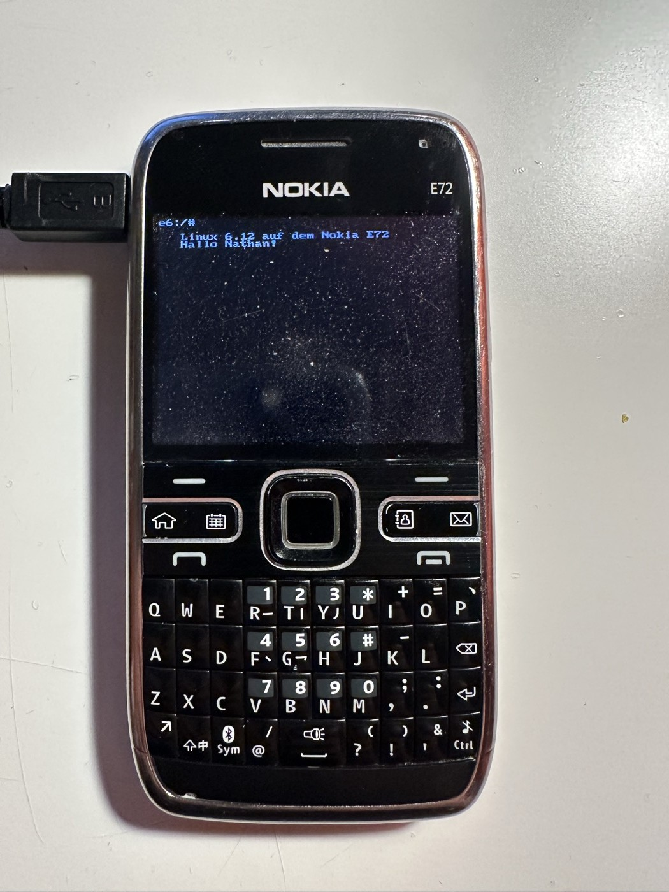

# Linux auf dem Nokia E72 (RM-530)

Linux 6.12 (Mainline-Basis) auf einem Nokia E72-1 (RM-530, Firmware **091.004**), gestartet aus dem laufenden Symbian wie eine App. Es ist eine Portierung des Nokia-E5-00-Zweigs von [rapuyama-linux](https://github.com/fluffleswaffles/rapuyama-linux) (Zweig `e5-port`) auf das E72, das dieselbe RapuYama-SoC-Familie und Symbian 9.3 nutzt, aber nur 128 MB RAM hat.

English version: [README.md](README.md). Die Anleitungen unter `docs/` sind auf Englisch.

**Stand: frühe Inbetriebnahme.** Linux bootet, zeigt eine Konsole auf dem Display, bietet eine Root-Shell über USB und hält das Telefon über Symbians Secure-Watchdog hinaus am Leben. Ein benutzbares Telefon-Betriebssystem ist es noch nicht: WLAN, SSH, Akkuanzeige und Laden über USB gehen; Modem und Ton noch nicht.

Langfristiges Ziel: ein energiesparendes Taschenterminal (Tastatur + Bildschirm + WLAN), mit dem man sich per SSH auf einen Rechner verbindet, auf dem Claude Code läuft.

## Was funktioniert

| Funktion | Stand | Hinweise |
| --- | --- | --- |
| Start aus Symbian (Lader LinuxE72, Scatter-Boot) | auf dem Gerät bestätigt | Image + dtb werden in einzelne 4-KB-Seiten geladen und bei ausgeschalteter MMU an ihren Platz kopiert |
| Kernel 6.12, ARM1176JZF-S, 128 MB | auf dem Gerät bestätigt | 90-MB-Bereich für Linux (0x11600000-0x17000000), 77 MB frei nach dem Start (Logs, vor dem Alpine-Userland) |
| RAM-Log nach einem Absturz lesbar (e72logs) | auf dem Gerät bestätigt | `earlycon=ramcon` bei 0x17000000 |
| Display, Framebuffer-Konsole (fbcon 40x30) | auf dem Gerät bestätigt | 320x240, E5-Displaytreiber von upstream, DMA-Übertragung per IRQ |
| USB-Gadget-Shell (CDC ACM, seriell) | auf dem Gerät bestätigt | BusyBox-Shell auf `ttyGS0` |
| Secure-Watchdog-Brücke (PA_SWD) | auf dem Gerät bestätigt | nur Firmware 091.004; Linux lief > 15 min (ohne Brücke: Neustart nach 3-4 min) |
| Tastaturmatrix (8 Zeilen x 7 Spalten) | teilweise bestätigt | 8 Tasten mit dem Testmodul geprüft; die übrigen 47 folgen Symbians Abfragetabelle und wurden nicht einzeln gedrückt |
| Tastaturtreiber im Kernel, Pins aus dem Device Tree (Patch 0003) | auf dem Gerät bestätigt | Treiber lädt; Tasten noch nicht einzeln geprüft |
| WLAN (TI WL1251 an SPI 2, Power GPIO 100, IRQ GPIO 73) | auf dem Gerät bestätigt | braucht Firmware + NVS vom eigenen Telefon, siehe [docs/wlan.md](docs/wlan.md); WPA2, DHCP und Ping ins Internet geprüft am 2026-11-18 |
| microSD-Slot, GDMA | auf dem Gerät bestätigt | Knoten aus `e5.dts`, Registerwerte mit dem Symbian des E72 abgeglichen |
| WFI-Leerlauf, zur Laufzeit schaltbar (Patch 0004) | auf dem Gerät bestätigt | Start mit `nohlt`; `echo 1 > /sys/module/idle/parameters/wfi`; rund 97 % der Leerlaufzeit im WFI |
| kexec (neuer Kernel ohne Umweg über Symbian) | auf dem Gerät bestätigt | `CONFIG_KEXEC=y`, `kexec` im Initramfs; Kernel per WLAN mit `tools/wput.py` geschickt, Watchdog-Brücke, Karte und WLAN danach wieder da |
| Alpine-Userland im Initramfs (wpa_supplicant, iw, dbclient/ssh, scp, kexec, apk) | teilweise bestätigt | `initramfs/e72-rootfs.sh` |
| TUN / WireGuard, 100-Hz-Takt | gebaut, ungetestet | |
| USB-Ethernet (CDC ECM, `usb0`) | funktioniert nicht | sendet, empfängt aber nur das erste Paket |
| Akkustand und Laden über USB (bq24151, Patches 0005 und 0007) | auf dem Gerät bestätigt | lädt mit etwa 390 mA an einem USB-Host, nur bei 5–40 °C; Steckernetzteil und 2-mm-Buchse nicht, siehe [docs/charging.md](docs/charging.md) |
| SSH-Server (dropbear), WLAN-Einstellungen dauerhaft auf der Karte | auf dem Gerät bestätigt | `initramfs/e72-boot.sh`: WLAN, SSH und WFI starten ohne Zutun |
| Zeitgeber ohne festen 1-kHz-Takt (Patch 0006, `e6.oneshot=1`) | experimentell | läuft, aber zusammen mit WFI bleiben Wartezeiten hängen; standardmäßig aus |
| Tastaturlicht und Displayhelligkeit | auf dem Gerät bestätigt | `/sys/class/backlight/gazoo-pwm0` (0–127) und `panel` (0–255) |
| Modem, Anrufe, SMS, Ton | nicht umgesetzt | |

Details und offene Punkte: [docs/status.md](docs/status.md).

## Installation

Die Anleitung ist in Schritte aufgeteilt. Alles läuft auf einem Linux- oder macOS-Rechner mit Docker; in den Flash-Speicher des Telefons wird nichts geschrieben, Linux läuft aus dem RAM und ein Neustart führt zurück zu Symbian.

1. [Voraussetzungen](docs/01-prerequisites.md): Telefon, Firmwareversion, Speicherkarte, Kabel, Werkzeuge
2. [Selbst signierte Apps unter Symbian erlauben](docs/02-unlock-symbian.md)
3. [Kernel, Device Tree, Initramfs und Lader bauen](docs/03-build.md)
4. [Auf die Karte kopieren und booten](docs/04-install-and-boot.md)
5. [USB-Shell](docs/05-usb-shell.md)
6. [Diagnose: RAM-Log und RAM-Abbild](docs/06-diagnostics.md)
7. [Kernelmodule ohne Neustart](docs/07-module-workflow.md)

Hintergrund:

- [Secure-Watchdog-Brücke](docs/secure-watchdog.md), auch was bei einer anderen Firmwareversion neu zu ermitteln ist
- [Tastatur](docs/keyboard.md)
- [WLAN und Kartenslot](docs/wlan.md)
- [Hardware](docs/hardware.md)

Fertige Binärdateien gibt es nicht (siehe [Rechtliches](#rechtliches)); alles wird aus den Quellen gebaut.

## Aufbau des Repositorys

| Pfad | Inhalt |
| --- | --- |
| `kernel/patches/` | sieben Patches für den Upstream-Kernel (`fluffleswaffles/linux`, Zweig `e5`) |
| `kernel/e72.dts` | Device Tree des E72, bindet upstream `e5.dts` ein |
| `kernel/build-e72.sh` | Kernelkonfiguration und Build (gehört nach `linux/kernel/` im Upstream-Baum) |
| `kernel/e72kp-testmodule/` | Tastatur-Testmodul, ohne Neustart ladbar |
| `loader/` | Patch für den Symbian-Lader (LinuxE72, e72dump, Scatter-Trampolin) und ein Build-Skript |
| `initramfs/` | `/init`-Hülle für das E72 und das Skript für das Alpine-Userland |
| `tools/` | Werkzeuge für den Rechner: Patch-Einspieler, Dateiübertragung über die serielle Shell, Sitzungsskripte, Log-Prüfung, Secure-Watchdog-Analyse, WLAN-Firmware-Extraktion |
| `logs/` | Boot-Logs und Shell-Sitzungen vom Gerät (18.11.2026) |
| `images/` | Foto der ersten Konsole auf dem Display |

## Danksagung

Diese Arbeit baut vollständig auf [rapuyama-linux](https://github.com/fluffleswaffles/rapuyama-linux) von fluffleswaffles (Projekt, E6-Port) und Kapina-Dev (E5-00-Port) auf. Alle verwendeten Projekte und Lizenzen: [CREDITS.md](CREDITS.md).

## Rechtliches

- Kernelpatches, Device Tree, Kernel-Build-Skript und Tastatur-Testmodul: GPL-2.0-only ([LICENSE](LICENSE)), wie der Kernel, den sie ändern.
- `loader/0001-loader-e72.patch` ändert Dateien von rapuyama-linux, das selbst keine Lizenz angibt (Stand 2026-11-18). Der Patch ist veröffentlicht, damit der Port nachbaubar ist; die Upstream-Anteile gehören ihren Autoren, auf deren Wunsch wird der Patch entfernt oder anders lizenziert.
- `tools/ensymble-run-on-install.patch`: GPL-2.0-or-later, wie Ensymble.
- Eigene Werkzeuge und Skripte (Dateien mit `SPDX-License-Identifier: MIT`): MIT ([LICENSES/MIT.txt](LICENSES/MIT.txt)).
- Dokumentation, Logs und Foto: CC BY 4.0 ([LICENSES/CC-BY-4.0.txt](LICENSES/CC-BY-4.0.txt)).

Bewusst nicht enthalten: Binärdateien von Nokia oder TI (WL1251-Firmware, NVS), RAM- oder ROM-Abbilder und alles daraus Ausgeschnittene, Disassemblate, Nokia-Servicedokumente, `.sis`-Pakete und Kernel-Images (das Image enthält die WLAN-Firmware). Die Anleitung erklärt, wie man das Nötige vom eigenen Telefon gewinnt.

Nokia, E72 und Symbian sind Marken ihrer jeweiligen Inhaber. Dieses Projekt steht in keiner Verbindung zu Nokia, HMD oder Texas Instruments. Nutzung auf eigene Gefahr: Das Entsperren verändert Symbians Installer, und ein fehlgeschlagener Start endet in einem Watchdog-Neustart.
