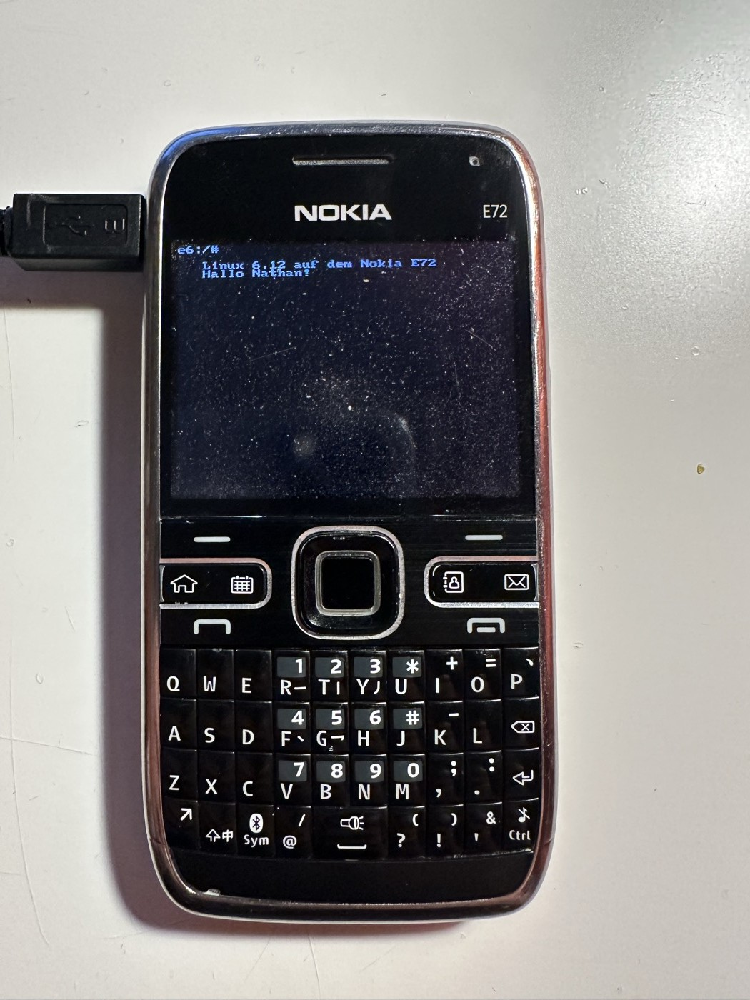

# Linux on the Nokia E72 (RM-530)

Mainline-based Linux 6.12 on a Nokia E72-1 (RM-530, firmware **091.004**), started from the running Symbian like an app. This is a port of the Nokia E5-00 branch of [rapuyama-linux](https://github.com/fluffleswaffles/rapuyama-linux) (branch `e5-port`) to the E72, which uses the same RapuYama SoC family and Symbian 9.3 but has only 128 MB of RAM.

German version: [README.de.md](README.de.md)

**Status: early bring-up.** Linux boots, shows a console on the phone's display, gives a root shell over USB and keeps the phone alive past Symbian's secure watchdog. It is not a usable phone OS yet: WLAN, SSH, battery gauge and USB charging work; modem and audio do not yet.

Long-term goal: an energy-efficient pocket terminal (keyboard + screen + WLAN) used to SSH into a machine that runs Claude Code.

## What works

| Feature | Status | Notes |
| --- | --- | --- |
| Boot from Symbian (LinuxE72 loader, scatter boot) | verified on device | Image + dtb are loaded into single 4 KB pages and copied into place with the MMU off |
| Kernel 6.12, ARM1176JZF-S, 128 MB | verified on device | 90 MB region for Linux (0x11600000-0x17000000), 77 MB available after boot (logs, before the Alpine userland was added) |
| RAM log readable after a crash (e72logs) | verified on device | `earlycon=ramcon` at 0x17000000 |
| Display, framebuffer console (fbcon 40x30) | verified on device | 320x240, upstream E5 display driver, DMA push per IRQ |
| USB gadget shell (CDC ACM serial) | verified on device | busybox shell on `ttyGS0` |
| Secure watchdog bridge (PA_SWD) | verified on device | firmware 091.004 only; Linux ran > 15 min (without it: reset after 3-4 min) |
| Keyboard matrix (8 rows x 7 columns) | partly verified | 8 keys checked with the test module; the other 47 keys follow Symbian's scan table and were not pressed one by one |
| In-kernel keyboard driver with pins from the device tree (patch 0003) | verified on device | driver loads; keys not yet checked one by one |
| WLAN (TI WL1251 on SPI 2, power GPIO 100, IRQ GPIO 73) | verified on device | needs firmware + NVS from your own phone, see [docs/wlan.md](docs/wlan.md); WPA2, DHCP and internet ping checked 2026-11-18 |
| microSD slot, GDMA | verified on device | nodes inherited from `e5.dts`, register values checked against the E72's Symbian |
| WFI idle, switchable at run time (patch 0004) | verified on device | boots with `nohlt`; `echo 1 > /sys/module/idle/parameters/wfi`; about 97 % of idle time in WFI |
| kexec (new kernel without going through Symbian) | verified on device | `CONFIG_KEXEC=y`, `kexec` in the initramfs; kernel sent over WLAN with `tools/wput.py`, watchdog bridge, card and WLAN up again afterwards |
| Alpine userland in the initramfs (wpa_supplicant, iw, dbclient/ssh, scp, kexec, apk) | partly verified | `initramfs/e72-rootfs.sh` |
| TUN / WireGuard, 100 Hz tick | built, untested | |
| USB ethernet (CDC ECM, `usb0`) | not working | sends, but receives only the first packet |
| Battery level and USB charging (bq24151, patches 0005 and 0007) | verified on device | charges with about 390 mA from a USB host, only at 5-40 °C; wall charger and 2 mm jack not, see [docs/charging.md](docs/charging.md) |
| SSH server (dropbear), WLAN settings kept on the card | verified on device | `initramfs/e72-boot.sh`: WLAN, SSH and WFI come up without any input |
| Timer without the fixed 1 kHz tick (patch 0006, `e6.oneshot=1`) | experimental | runs, but waits stall when combined with WFI; off by default |
| Keyboard light and display brightness | verified on device | `/sys/class/backlight/gazoo-pwm0` (0-127) and `panel` (0-255) |
| Modem, calls, SMS, audio | not done | |

Details and open issues: [docs/status.md](docs/status.md).

## How to install

The guide is split into steps. Everything runs on a Linux or macOS host with Docker; nothing is written to the phone's flash, Linux runs from RAM and a reboot returns to Symbian.

1. [Prerequisites](docs/01-prerequisites.md): phone, firmware version, memory card, cable, host tools
2. [Allow self-signed apps on Symbian](docs/02-unlock-symbian.md)
3. [Build kernel, device tree, initramfs and loader](docs/03-build.md)
4. [Copy to the card and boot](docs/04-install-and-boot.md)
5. [USB shell](docs/05-usb-shell.md)
6. [Diagnostics: RAM log and RAM dump](docs/06-diagnostics.md)
7. [Kernel modules without rebooting](docs/07-module-workflow.md)

Background:

- [Secure watchdog bridge](docs/secure-watchdog.md), including what to redo for another firmware version
- [Keyboard](docs/keyboard.md)
- [Audio and vibra](docs/audio-vibra.md)
- [Idle, wake-up and kexec](docs/idle-and-kexec.md)
- [WLAN and card slot](docs/wlan.md)
- [Hardware notes](docs/hardware.md)

No prebuilt binaries are provided (see [Legal](#legal)); you build everything from source.

## Repository layout

| Path | Contents |
| --- | --- |
| `kernel/patches/` | seven patches for the upstream kernel tree (`fluffleswaffles/linux`, branch `e5`) |
| `kernel/e72.dts` | E72 device tree, includes upstream `e5.dts` |
| `kernel/build-e72.sh` | kernel config + build script (goes to `linux/kernel/` in the upstream tree) |
| `kernel/e72kp-testmodule/` | keyboard test module, loadable without reboot |
| `loader/` | patch for the Symbian loader (LinuxE72, e72dump, scatter trampoline) and a build script |
| `initramfs/` | `/init` wrapper for the E72 and the Alpine userland script |
| `tools/` | host tools: patch applier, serial file transfer, session scripts, log checker, secure-watchdog analysis, WLAN firmware extraction |
| `logs/` | boot logs and shell sessions from the device (2026-11-18) |
| `images/` | photo of the first console on the display |

## Credits

This work stands entirely on [rapuyama-linux](https://github.com/fluffleswaffles/rapuyama-linux) by fluffleswaffles (E6 port, project) and Kapina-Dev (E5-00 port). Full list of upstream projects and licences: [CREDITS.md](CREDITS.md).

## Legal

- Kernel patches, the device tree, the kernel build script and the keyboard test module: GPL-2.0-only ([LICENSE](LICENSE)), like the kernel they patch.
- `loader/0001-loader-e72.patch` modifies files of upstream rapuyama-linux, which declares no licence of its own (checked 2026-11-18). The patch is published so the port can be reproduced; the upstream parts remain the property of their authors, and the patch will be removed or relicensed at their request.
- `tools/ensymble-run-on-install.patch`: GPL-2.0-or-later, like Ensymble.
- Own tools and scripts (files marked `SPDX-License-Identifier: MIT`): MIT ([LICENSES/MIT.txt](LICENSES/MIT.txt)).
- Documentation, logs and the photo: CC BY 4.0 ([LICENSES/CC-BY-4.0.txt](LICENSES/CC-BY-4.0.txt)).

Not included, on purpose: Nokia or TI binaries (WL1251 firmware, NVS), RAM or ROM dumps and anything cut from them, disassemblies, Nokia service documents, `.sis` packages and kernel images (the kernel image embeds the WLAN firmware). The guide explains how to produce what you need from your own phone.

Nokia, E72 and Symbian are trademarks of their owners. This project is not affiliated with Nokia, HMD or Texas Instruments. Use at your own risk: the unlocking step modifies Symbian's installer, and a failed boot ends in a watchdog reset.
